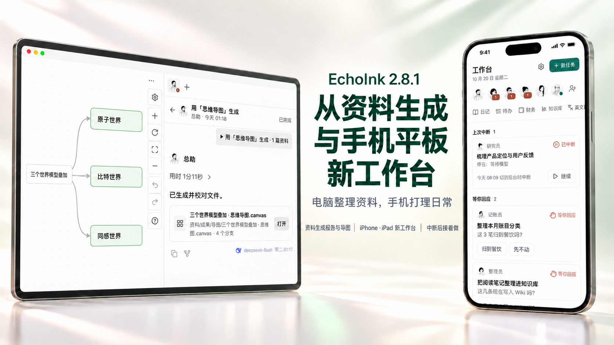

  

<h1 align="center">EchoInk Agent</h1>

Your notes, with an AI companion. Built for Obsidian.

  <a href="https://echoink.cn">Official website</a> ·
  <a href="https://echoink.cn/install">Download &amp; installation</a> ·
  <a href="#whats-new-in-281">What's new</a> ·
  <a href="#privacy-and-data">Privacy</a> ·
  <a href="README_CN.md">中文</a>

  
  
  

<a href="https://echoink.cn"><strong>Visit echoink.cn</strong></a>

EchoInk is a personal knowledge agent that lives in Obsidian. Chat with your notes, organize knowledge, keep visible and editable long-term memory, and record everyday life. Your notes stay in your vault; connect your own supported model service for AI features. Normal installation does not require Codex CLI.

## What's new in 2.8.1

**Generate from notes and work from phone or tablet.** On desktop, generate reports and Canvas mind maps from selected notes with built-in or custom templates, then follow source links back to your notes.

**A new workbench and multi-agent tasks.** The desktop Home gathers work that needs your response, running tasks, and completed results. Reminders for to-dos, sources, and PDFs can start an Agent task with the relevant content.

- Create Agents with their own identity, model, and available capabilities. Use each Agent's task list to check progress, handle approvals, and continue conversations.
- Interrupted tasks keep their reason and last stage. **Continue from here** checks operations and file changes, prompting you to review uncertain results. Tasks do not run after Obsidian closes or restart automatically.
- Dedicated pages for Journal, To-dos, Finance, Knowledge, English Diary, and PDF let you edit by date, link to-dos to projects, browse Knowledge folders, and revisit English drafts, PDF originals, and saved results.
- Six settings tabs—General, Models, Agent, Capabilities, Modules, and Account and membership—and updated onboarding provide clear places for Agents, your profile, memory, and module folders.
- Knowledge recall adds body text, sections, and reference navigation. Memory stays closer to the current question and explicitly named projects. Knowledge retrieval excludes private-memory and internal plugin data; check sources for important information.
- Custom Knowledge folders, folder graphs, selection questions and annotations, and saving answers as notes connect reading with chat. English Diary improves native editing, expression review, and daily expressions on Home.

Finance, English Diary, and PDF reading require active PRO. Minimal appearance is free; Highlighter and Manifesto require active PRO. The companion theme is provided separately: download it from [echoink.cn/theme](https://echoink.cn/theme) and install it in Obsidian. **PRO does not include model credits.** Campaign and subscription details are on the [website](https://echoink.cn/plans). See the [CHANGELOG](CHANGELOG.md) for full release notes and usage instructions.

## Download and documentation

Visit [echoink.cn](https://echoink.cn) for [installation](https://echoink.cn/install), [features](https://echoink.cn/features), and [help](https://echoink.cn/support). The repository's [Releases](https://github.com/AKin-lvyifang/codex-echoink/releases) remain the official source of plugin files.

Requires **Obsidian 1.11.4 or later**. **Make a complete backup of your vault, plugin settings, and data before upgrading.** For manual upgrades, replace only the official `main.js`, `manifest.json`, and `styles.css`, keep your existing settings and data files, and re-enable the plugin. To roll back, restore the complete pre-upgrade backup together with the matching older plugin; replacing only the plugin files with an older version is not a supported downgrade.

Mobile Beta adds separately designed iPhone and iPad workbenches, multi-Agent tasks, six settings groups, and pages for journals, to-dos, finance, knowledge, and English diaries; interrupted tasks continue when you choose, and handing something to an Agent only prepares the text. Note generation, generation-template settings, and PDF close reading are desktop-only; tasks do not sync across devices. Attachments, CLI, and desktop background knowledge tasks are not yet available; Skills use only the available mobile tools, and MCP currently saves configuration only. Validation on iPhone, Android, some native iPad flows, and native Windows and Linux environments remains incomplete.

The plugin file exceeds Obsidian Sync Standard's 5 MB per-file limit. Install or update the plugin independently on each device through the official download or Community Plugins; do not rely on Sync Standard to transfer this file.

## Privacy and data

- Conversations, notes, knowledge, memory, diary content, and financial records are stored locally. The plugin does not upload your entire vault by default.
- EchoInk's account service at **https://echoink.cn** handles registration, sign-in, email verification, redemption, subscriptions, and device authorization. It receives the account information and authorization data required for those requests, including a generated device identity. An EchoInk account and an active entitlement are required for PRO plugins; ordinary chat and Knowledge do not require an EchoInk account.
- Workbench check-in is an online account action. Opening the Workbench while signed in queries your account's status for the local date. Only pulling the weather doll down or pressing Arrow Down submits a manual check-in, sending your account identity through the existing login token, local date, and time zone to **https://echoink.cn**. Check-ins are saved with your server account and cached only in memory by the plugin. There is no automatic check-in or upload of Agent usage days, notes, or conversation content.
- On desktop, account sessions and device authorization are encrypted under **`~/.echoink/membership/`**, outside the vault. Operating-system secure storage protects the shared device authorization; Obsidian's secret storage protects each vault's account session separately. If secure storage is unavailable, persistent device authorization cannot complete, and existing credentials are preserved.
- On mobile, account sessions and authorization use the current vault's Obsidian secret storage, not ordinary plugin settings. Activation applies to each vault's client instance, so different vaults on the same device may occupy separate slots. Unlink unused instances in device management. If secure storage is unavailable, state is kept only for the current session.
- Provider API keys and OpenAI Codex Beta sign-in credentials are saved in plugin settings for the current vault. Use trusted devices and vaults.
- Your selected model service receives the prompts, notes, attachments, memory, and tool results needed for the current AI request. Model services may require their own account and charge separately; image input requires a vision-capable model.
- Desktop conversations can use a local workspace outside the vault. File access follows the selected permission mode; Full access removes the workspace boundary. Outside-vault attachments are read when you explicitly select, drag, or paste them.
- Tavily web search is off by default. When enabled, queries go to `api.tavily.com`, and returned snippets and links go to your model. Tavily needs its own account and API key; connection tests also perform a basic search and consume one credit. See [Tavily's pricing policy](https://docs.tavily.com/documentation/api-credits).
- Knowledge retrieval excludes the private-memory and internal plugin data folders. This is not a global access restriction for every file tool or third-party service.
- Local PDF text extraction runs on your device. MinerU enhanced parsing sends the PDF to MinerU, requires separate credentials and credits, and follows that service's retention policy. Extracted content needed for reading notes or translations is sent to your selected model.
- Link capture uses the plugin's built-in fetcher to access pages you explicitly submit.
- Custom Providers and MCP connections contact the services or local commands you configure. Local MCP processes run with your operating-system user permissions and inherit the application environment; approving tools in the plugin does not restrict those processes to the workspace.
- The plugin has no client usage telemetry. Website and account-service data handling is described in the [privacy policy](https://echoink.cn/support#privacy).

## License

EchoInk uses **component-based licensing**: the base is open source under the standard [MIT License](licenses/MIT.txt); Finance, English Diary, membership/activation and the other PRO paths listed in [LICENSE](LICENSE) use the [EchoInk PRO License](licenses/PRO-LICENSE.txt). The complete plugin package is not wholly MIT-licensed or wholly OSI open source. The licenses apply to different components, not as alternatives for the entire product.

The MIT base permits modification, redistribution and commercial use. PRO source is available for personal, noncommercial study. A valid PRO entitlement permits normal personal, work and internal business use of unmodified official releases; it does not permit bypassing activation, modifying or redistributing PRO code, or incorporating it into another commercial product. Those uses require a separate written license. A subscription or activation code is a product-use entitlement, not a source-code resale license.

Both parts ship in the same official plugin; activation does not require another installation. Earlier MIT grants and third-party rights remain in force. Your own notes and independently created outputs do not become subject to the PRO license merely because you used EchoInk. See [LICENSE](LICENSE) for the exact scope, asset exceptions and preserved rights, and [THIRD_PARTY_NOTICES.md](THIRD_PARTY_NOTICES.md) for third-party material.
