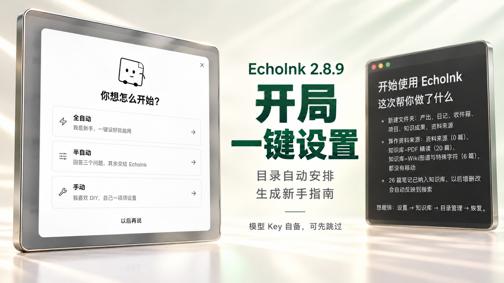

  

<h1 align="center">EchoInk Agent</h1>

Your notes, with an AI companion. Built for Obsidian.

  <a href="https://echoink.cn">Official website</a> ·
  <a href="https://echoink.cn/install">Download &amp; installation</a> ·
  <a href="https://echoink.cn/features">Features</a> ·
  <a href="#news">News</a> ·
  <a href="#quick-start">Quick start</a> ·
  <a href="#explore">Explore</a> ·
  <a href="#privacy-and-data">Privacy</a> ·
  <a href="README_CN.md">中文</a>

  
  
  

EchoInk is a personal knowledge agent that lives in Obsidian. Chat with your notes, organize knowledge, keep visible and editable long-term memory, and record everyday life. Your notes stay in your vault; connect your own supported model service for AI features. Normal installation does not require Codex CLI.

## Core features

| What you want to do | How EchoInk helps |
| --- | --- |
| Chat with your notes | Chat with notes; on desktop, add attachments or propose edits with @Agent in notes (PRO) |
| Turn sources into knowledge | Organize folders by purpose, follow related sources from a question, maintain knowledge incrementally, and trace answers to sources |
| Let AI remember you | View, correct, export, forget, and restore long-term memory; managing existing memory needs no model connection |
| Record everyday life | Keep journals and manage to-dos; on desktop, enable automatic journal organization, with PRO required for finances |
| Share work across agents | Dispatch tasks to different agents and view reminders on the workbench; hire expert agents on desktop (PRO) |
| Create outputs | Generate notes, Canvas layouts, or drawings from sources on desktop, or use PDF reading (PRO) |

## News

| Version | Date | Update |
| --- | --- | --- |
| [2.8.9](https://github.com/AKin-lvyifang/codex-echoink/releases/tag/2.8.9) | 2026-11-01 | One-click setup, drawings, journal naming, and expert hiring |
| [2.8.8](https://github.com/AKin-lvyifang/codex-echoink/releases/tag/2.8.8) | 2026-10-29 | Automatic journal-to-task and finance organization on desktop; finances require PRO |
| [2.8.7](https://github.com/AKin-lvyifang/codex-echoink/releases/tag/2.8.7) | 2026-10-28 | Grouped workbench entries, DeepSeek search, and run-record export |
| [2.8.6](https://github.com/AKin-lvyifang/codex-echoink/releases/tag/2.8.6) | 2026-10-27 | @Agent in notes (PRO), with proposed edits written back after confirmation |
| [2.8.5](https://github.com/AKin-lvyifang/codex-echoink/releases/tag/2.8.5) | 2026-10-26 | Three appearances and image galleries; model-connection and memory-identity fixes |
| [2.8.4](https://github.com/AKin-lvyifang/codex-echoink/releases/tag/2.8.4) | 2026-10-23 | Knowledge maintenance, chat formatting, and workbench display fixes |

See the [CHANGELOG](CHANGELOG.md) and [Releases](https://github.com/AKin-lvyifang/codex-echoink/releases) for the full history.

**Upgrade every device to 2.8.9.** Finance, English Diary, PDF reading, @Agent in notes, expert hiring, and the EchoInk MCP server require active PRO. **PRO does not include model credits.** See the [website](https://echoink.cn/plans) for current offers and prices. **Mobile remains in Beta; this version has not completed phone hardware acceptance.** Supported features are listed below.

## Quick start

| Step | Action | Instructions |
| --- | --- | --- |
| 1 | Install | Search for EchoInk in Obsidian's community plugins, or download `main.js`, `manifest.json`, and `styles.css` from [Releases](https://github.com/AKin-lvyifang/codex-echoink/releases) into `.obsidian/plugins/codex-echoink/`, then enable it in Community Plugins settings. Requires Obsidian 1.11.4 or later |
| 2 | Set up | On desktop, open setup from the workbench and choose Automatic, Guided, or Manual. For Automatic or Guided, review the plan before confirming; existing notes stay in place, and a starter guide opens when setup finishes |
| 3 | Connect a model | Bring your own model API key, or connect later. Directory setup and guide generation do not call a model; connection tests and source extraction you choose to enable use model credits |
| 4 | Start | Open the workbench to begin a conversation; @Agent in notes requires active PRO |

**Make a complete backup of your vault, plugin settings, and data before upgrading.** For manual upgrades, replace only the official `main.js`, `manifest.json`, and `styles.css`, keep your existing settings and data files, and re-enable the plugin. To roll back, restore the complete pre-upgrade backup together with the matching older plugin; replacing only the plugin files with an older version is not a supported downgrade.

The plugin file exceeds Obsidian Sync Standard's 5 MB per-file limit. Install or update the plugin independently on each device through the official download or Community Plugins; do not rely on Sync Standard to transfer this file.

## Explore

### 💬 Conversations and knowledge

| Feature | Description | Basic | PRO |
| --- | --- | --- | --- |
| Agent conversations | Ask with notes, continue conversations, or archive them; desktop supports attachments | ✅ | ✅ |
| Knowledge Q&A (Ask) | Follow related sources and cite the sources actually used | ✅ | ✅ |
| Knowledge maintenance | Organize new or changed sources incrementally, update existing knowledge, and preserve handwritten content | ✅ | ✅ |
| Generate from sources | Generate notes, Canvas layouts, or editable drawings on desktop; drawings require Excalidraw 2.29 or later enabled and a model supporting tool calls | ✅ | ✅ |
| PDF reading and extraction | Extract originals and generate translations and reading notes on desktop; optional MinerU enhanced parsing | ❌ | ✅ |
| @Agent in notes | Ask in a note, review proposed edits, and confirm changes before writing them back; undo is available | ❌ | ✅ |
| Web search | Off by default; choose Tavily or DeepSeek, with separate service charges | ✅ | ✅ |

### 🧠 Memory and methods

| Feature | Description | Basic | PRO |
| --- | --- | --- | --- |
| Long-term memory | Browse, correct, export, forget, and restore; knowledge retrieval excludes private memory | ✅ | ✅ |
| Skills (built-in and custom) | Built-in basic Skills, custom Skills, and basic knowledge review | ✅ | ✅ |
| Official methodology Skills and enhanced knowledge review | Seven official methodology Skills and enhanced knowledge review download on demand | ❌ | ✅ |
| EchoInk MCP server | On desktop, share authorized knowledge, profile, and memories with external agents on the same computer; off by default and read-only | ❌ | ✅ |

### 📅 Everyday life

| Feature | Description | Basic | PRO |
| --- | --- | --- | --- |
| Workbench | View tasks, reminders, starter cards, and weather for your chosen city in one place on desktop | ✅ | ✅ |
| Journal | Customize naming; preview moves for older journals and undo those moves on desktop | ✅ | ✅ |
| To-dos | Manage categories, due dates and times, and completion; enable automatic journal-to-task organization on desktop | ✅ | ✅ |
| Finance | Manage income, expenses, budgets, bill imports, and analysis | ❌ | ✅ |
| English diary | Generate English drafts on desktop, correct errors or clearly unnatural English, and collect useful expressions | ❌ | ✅ |

### 🤖 Agent team

| Feature | Description | Basic | PRO |
| --- | --- | --- | --- |
| Multi-agent tasks | Manage tasks for different agents on the workbench; choose when interrupted tasks continue. On mobile, handing something to an agent only prepares the text | ✅ | ✅ |
| Expert hiring | Browse and hire experts on desktop, continue from their avatars, and retain conversations after dismissal | ❌ | ✅ |

### 🎨 Appearance and platforms

| Item | Description |
| --- | --- |
| Appearance | Minimal is free; Highlighter and Manifesto require active PRO. Install the companion theme separately from [echoink.cn/theme](https://echoink.cn/theme) |
| Desktop | Provides the desktop entries described above; validation in native Windows and Linux environments remains incomplete |
| Mobile Beta | Mobile Beta adds separately designed iPhone and iPad workbenches, multi-Agent tasks, six settings groups, and pages for journals, to-dos, finance, knowledge, and English diaries; interrupted tasks continue when you choose, and handing something to an Agent only prepares the text. Note generation, generation-template settings, and PDF close reading are desktop-only; tasks do not sync across devices. Attachments, CLI, and desktop background knowledge tasks are not yet available; Skills use only the available mobile tools, and MCP currently saves configuration only. Validation on iPhone, Android, some native iPad flows, and native Windows and Linux environments remains incomplete. |

## Privacy and data

### Where data is stored

- **Local content:** Conversations, notes, knowledge, memory, diary content, and financial records are stored locally. The plugin does not upload your entire vault by default.

- **Model credentials:** Provider API keys and OpenAI Codex Beta sign-in credentials are saved in plugin settings for the current vault. Use trusted devices and vaults.

- **Desktop account storage:** On desktop, account sessions and device authorization are encrypted under **`~/.echoink/membership/`**, outside the vault. Operating-system secure storage protects the shared device authorization; Obsidian's secret storage protects each vault's account session separately. If secure storage is unavailable, persistent device authorization cannot complete, and existing credentials are preserved.

- **Mobile account storage:** On mobile, account sessions and authorization use the current vault's Obsidian secret storage, not ordinary plugin settings. Activation applies to each vault's client instance, so different vaults on the same device may occupy separate slots. Unlink unused instances in device management. If secure storage is unavailable, state is kept only for the current session.

### Features that connect to echoink.cn

- **Account and authorization:** EchoInk's account service at **https://echoink.cn** handles registration, sign-in, email verification, redemption, subscriptions, and device authorization. It receives the account information and authorization data required for those requests, including a generated device identity. An EchoInk account and an active entitlement are required for PRO plugins; ordinary chat and Knowledge do not require an EchoInk account.

- **Official PRO Skills:** Official PRO Skills download on demand from **https://echoink.cn**. Seven methodology Skills are delivered remotely; knowledge review retains its complete local basic version and uses a remote enhancement when PRO is valid. The catalog is public, including names, summaries and available comparison links. Content requires sign-in, unified PRO access and an activated device. Finance, English Diary, basic Obsidian operations, Quick Journal and to-do Skills remain bundled.

- **Skill requests and cache:** Skill downloads use the account service to send the login token, Skill ID, device ID, current signed lease, plugin version, platform and optional cached version. They send no notes or conversations. Versioned Markdown is cached in **`skill-cache/`** under the current Vault’s actual plugin data directory, following its configured directory and existing data-root selection, isolated by account, service URL and device. These are ordinary local files and can be copied. Every use requires a valid device lease and less than 7 days since the full content’s `issuedAt`. Cache reads and “not modified” responses never extend that period. Only temporary network failures permit fallback to a still-valid cache. Sign-out, expiry, device revocation or a known entitlement revocation stops access; a fully offline device cannot immediately learn of remote revocation. Each run fixes one content version; updates apply to a later run. Skill text grants no tools or permissions.

- **Expert catalogs and content:** Expert catalogs and content are fetched from echoink.cn. Content downloads require active PRO and device authorization. Requests include the expert ID, device ID, signed lease, plugin version, platform, and optional cached version; these download requests send no notes or conversations. Downloaded content is cached in `expert-cache/` under the current plugin directory.

- **Weather:** Weather is optional. Searching for a city sends the search text to echoink.cn. Once you select a city, EchoInk stores its ID and name in this vault's plugin settings and sends only the city ID to echoink.cn when the workbench opens and every 30 minutes while visible. Weather requests contain no login token or account data; EchoInk does not read device location or store weather history. Weather is a near-term estimate from MET Norway, not a local observation. Weather and city sources, licenses and adaptations remain visible in General settings.

- **Workbench check-in:** Workbench check-in is an online account action. Opening the Workbench while signed in queries your account's status for the local date. Only pulling the weather doll down or pressing Arrow Down submits a manual check-in, sending your account identity through the existing login token, local date, and time zone to **https://echoink.cn**. Check-ins are saved with your server account and cached only in memory by the plugin. There is no automatic check-in or upload of Agent usage days, notes, or conversation content.

- **Run records and reports:** From a session’s **…** menu, you can export its run records or voluntarily upload a problem report to **echoink.cn**. Reports include conversations, note excerpts read by the agent, tool and runtime logs, environment details, and errors, together with your description and optional contact information. Signed-in submissions are linked to your account. Recognized secrets are hidden automatically; review the preview before uploading. Reports are used for troubleshooting and may be analyzed with AI assistance. They are retained for **180 days**; to request earlier deletion, contact the author through [support](https://echoink.cn/support) with the report ID. Exporting alone saves a file in your vault without uploading it.

- **Static PRO information:** The plugin’s own interface includes static PRO benefit information and official Skill comparison links opened when you click them. It does not load dynamic online advertising.

### Data sent to third-party services

- **Model requests:** Your selected model service receives the prompts, notes, attachments, memory, and tool results needed for the current AI request. Model services may require their own account and charge separately; image input requires a vision-capable model.

- **Web search:** Web search is off by default, with a choice of Tavily or DeepSeek. When enabled, queries go to the selected service at `api.tavily.com` or `api.deepseek.com`, and returned snippets and links go to your model. Each service uses its own account and API key and bills usage separately; connection tests also perform a real search. Tavily connection tests use basic search and consume one credit; see [Tavily's pricing policy](https://docs.tavily.com/documentation/api-credits). DeepSeek query limits and billing are described in its [search documentation](https://api-docs.deepseek.com/guides/search/).

- **PDF parsing:** Local PDF text extraction runs on your device. MinerU enhanced parsing sends the PDF to MinerU, requires separate credentials and credits, and follows that service's retention policy. Extracted content needed for reading notes or translations is sent to your selected model.

- **Link capture:** Link capture uses the plugin's built-in fetcher to access pages you explicitly submit.

- **Custom services and MCP:** Custom Providers and MCP connections contact the services or local commands you configure. Local MCP processes run with your operating-system user permissions and inherit the application environment; approving tools in the plugin does not restrict those processes to the workspace.

### Local permissions and external agents

- **Desktop workspace:** Desktop conversations can use a local workspace outside the vault. File access follows the selected permission mode; Full access removes the workspace boundary. Outside-vault attachments are read when you explicitly select, drag, or paste them.

- **EchoInk MCP server:** EchoInk’s desktop MCP server is PRO, off by default, read-only, and listens only on this computer’s loopback address while Obsidian is running. You separately authorize Knowledge and personal memory/profile access. External Agents can receive note excerpts, source paths and revisions, concept links, your profile and memories, and may send them to their model providers or retain them. EchoInk cannot control those records or recall content already sent. Turn off sharing or regenerate the token to stop future access.

- **Knowledge retrieval scope:** Knowledge retrieval excludes the private-memory and internal plugin data folders. This is not a global access restriction for every file tool or third-party service.

### What the plugin does not do

- **Client telemetry:** The plugin has no client usage telemetry. Website and account-service data handling is described in the [privacy policy](https://echoink.cn/support#privacy).

## License

EchoInk uses **component-based licensing**: the base is open source under the standard [MIT License](licenses/MIT.txt); Finance, English Diary, membership/activation and the other PRO paths listed in [LICENSE](LICENSE) use the [EchoInk PRO License](licenses/PRO-LICENSE.txt). The complete plugin package is not wholly MIT-licensed or wholly OSI open source. The licenses apply to different components, not as alternatives for the entire product.

The MIT base permits modification, redistribution and commercial use. PRO source is available for personal, noncommercial study. A valid PRO entitlement permits normal personal, work and internal business use of unmodified official releases; it does not permit bypassing activation, modifying or redistributing PRO code, or incorporating it into another commercial product. Those uses require a separate written license. A subscription or activation code is a product-use entitlement, not a source-code resale license.

Both parts ship in the same official plugin; activation does not require another installation. Earlier MIT grants and third-party rights remain in force. Previously published methodology Skill text remains available under MIT; remote delivery does not withdraw those rights. The content publisher will specify the license for new server-delivered content separately. Your own notes and independently created outputs do not become subject to the PRO license merely because you used EchoInk. See [LICENSE](LICENSE) for the exact scope, asset exceptions and preserved rights, and [THIRD_PARTY_NOTICES.md](THIRD_PARTY_NOTICES.md) for third-party material.
