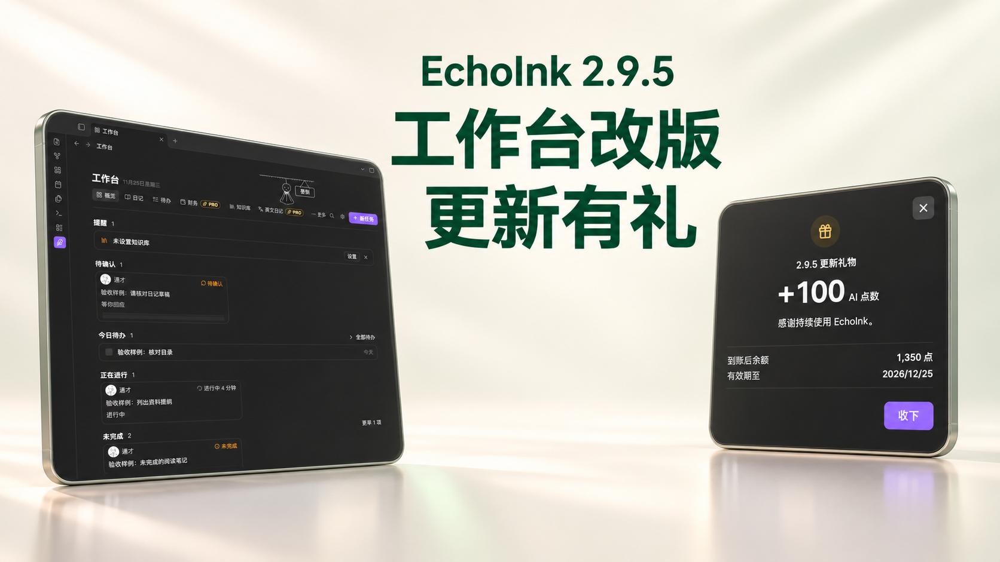
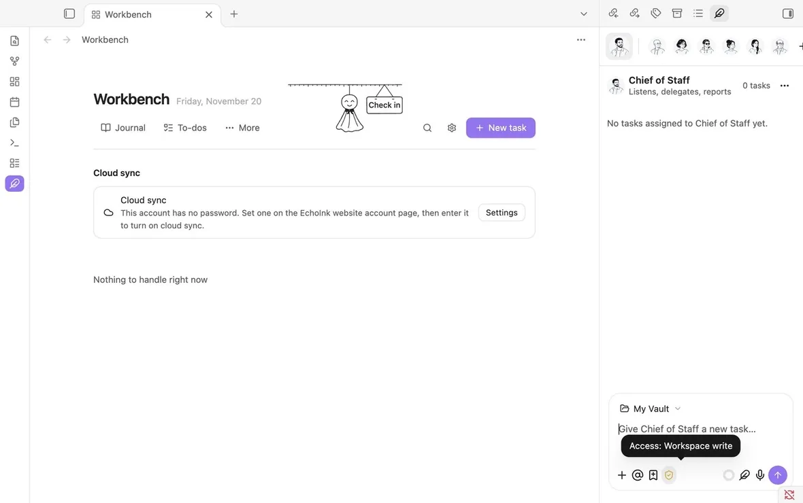
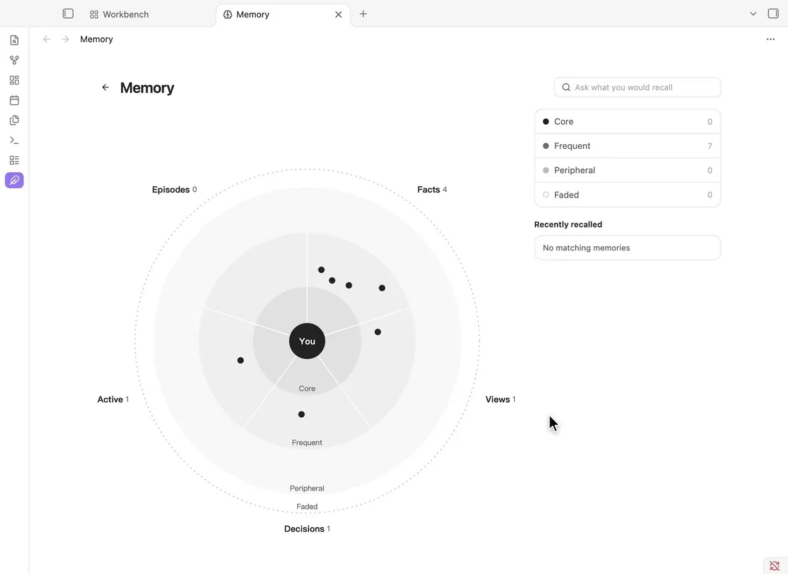
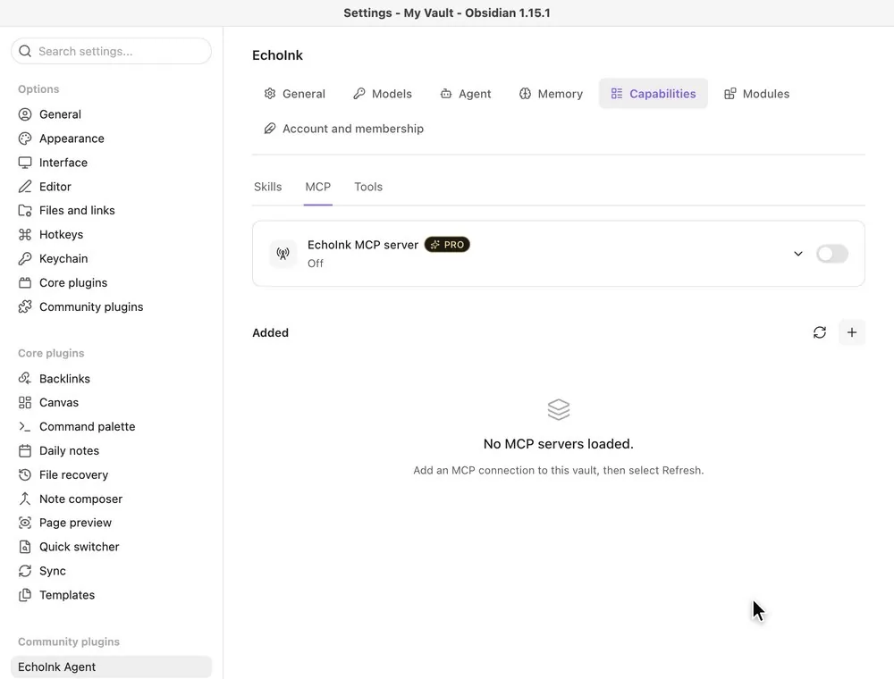

  

<h1 align="center">EchoInk Agent</h1>

An AI agent plugin for Obsidian. Chat with your notes, get answers with sources, keep your knowledge base organized, and let it remember what matters — in memory you can read and edit.

<a href="https://obsidian.md/plugins?id=codex-echoink"><b>Install in Obsidian</b></a>

  <a href="https://echoink.cn">Website</a> ·
  <a href="https://echoink.cn/features">Features</a> ·
  <a href="https://echoink.cn/plans">Pricing</a> ·
  <a href="#privacy-at-a-glance">Privacy</a> ·
  <a href="README_CN.md">中文</a>

  
  
  
  

## What you can do

| | |
| --- | --- |
| 💬 **Chat with your notes** | Ask anything about your vault. Answers cite the notes they actually used. |
| 📚 **Turn sources into knowledge** | Organize new material into a knowledge base, with health checkups and previewed repairs. |
| 🧠 **Memory you can see and edit** | EchoInk learns about you over time. Browse, correct, pin, or forget any memory. |
| 📅 **Journal, to-dos, and finances** | Add a task or log an expense in one line, and see your schedule and spending on a calendar. EchoInk can also pull tasks and expenses from your journal. |
| 🤖 **A small AI team** | An assistant plans and delegates, role agents do the work, and you approve the decisions. |
| ✏️ **Create from your sources** | Generate notes, Canvas layouts, and drawings from the material you already have. |
| 🔌 **Your notes as context for other agents** | A local MCP server lets the agents you already use read the knowledge and memory you authorize. |

Your notes stay in your vault. Bring your own model API key, or use the built-in models with AI credits.

    

  
  

Recorded in EchoInk 2.9.0 with a demo vault.

## Get started

1. **Install.** [Open EchoInk in Obsidian](https://obsidian.md/plugins?id=codex-echoink), or search `EchoInk` in Community plugins. Requires Obsidian 1.11.4+.
2. **Set up.** Open the workbench and pick Automatic, Guided, or Manual setup. Your existing notes stay where they are.
3. **Connect a model.** Add an API key for OpenAI or a compatible provider, or sign in to use the built-in models, then start chatting.

## Free, PRO, and Max

| | Free | PRO | Max |
| --- | :---: | :---: | :---: |
| Chat, knowledge Q&A, knowledge base and checkups | ✅ | ✅ | ✅ |
| Long-term memory and memory constellation | ✅ | ✅ | ✅ |
| Journal, to-dos, workbench | ✅ | ✅ | ✅ |
| AI team, module owners, custom Skills | ✅ | ✅ | ✅ |
| @Agent inside notes, PDF reading | — | ✅ | ✅ |
| Finance, English diary | — | ✅ | ✅ |
| Expert hiring and submissions, official methodology Skills, EchoInk MCP server | — | ✅ | ✅ |
| Cloud sync | — | 1 GB | 5 GB |
| AI credits for built-in models, per month | — | 500 | 3,000 |

You can bring your own model API key on any plan. Signed-in accounts can also receive eligible one-time workbench gifts. See [current plans and prices](https://echoink.cn/plans).

Full feature list

### 💬 Conversations and knowledge

| Feature | Description | Basic | PRO |
| --- | --- | --- | --- |
| Agent conversations | Ask with notes, continue conversations, or archive them; desktop supports attachments | ✅ | ✅ |
| Knowledge Q&A (Ask) | Follow related sources and cite the sources actually used | ✅ | ✅ |
| Knowledge systems and checkups | Organize domain trees and run quick or deep checkups on desktop; preview and confirm repairs. Review model judgments; deep checkups and organization use model credits | ✅ | ✅ |
| Knowledge maintenance | Organize new or changed sources incrementally, update existing knowledge, and preserve handwritten content | ✅ | ✅ |
| Generate from sources | Generate notes, Canvas layouts, or editable drawings on desktop; drawings require Excalidraw 2.29 or later enabled and a model supporting tool calls | ✅ | ✅ |
| PDF reading and extraction | Extract originals and generate translations and reading notes on desktop; optional MinerU enhanced parsing | ❌ | ✅ |
| @Agent in notes | Ask in a note, review proposed edits, and confirm changes before writing them back; undo is available | ❌ | ✅ |
| Web search | Off by default; choose Tavily or DeepSeek, with separate service charges | ✅ | ✅ |

### 🧠 Memory and methods

| Feature | Description | Basic | PRO |
| --- | --- | --- | --- |
| Long-term memory | Browse, correct, export, forget, restore, and pin; fading does not delete memories, and knowledge retrieval excludes private memory | ✅ | ✅ |
| Memory constellation | Inspect profile, memories, and sources on desktop via Settings → Memory; correct, pin, or restore memories | ✅ | ✅ |
| Skills (built-in and custom) | Built-in basic Skills, custom Skills, and basic knowledge review | ✅ | ✅ |
| Official methodology Skills and enhanced knowledge review | Seven official methodology Skills and enhanced knowledge review download on demand | ❌ | ✅ |
| EchoInk MCP server | On desktop, let external agents on the same computer fetch authorized knowledge, profile, and memories for a task in one call. Read-only and off by default | ❌ | ✅ |

### 📅 Everyday life

| Feature | Description | Basic | PRO |
| --- | --- | --- | --- |
| Workbench | See reminders, items awaiting confirmation, today’s to-dos, and task progress on desktop. Switch modules in the same workbench tab and customize its navigation | ✅ | ✅ |
| Workbench gifts | Sign in to claim eligible gifts on desktop, iPhone, and iPad | ✅ | ✅ |
| AI points and model picker | On desktop, see your balance in chat and find Xiaoecho in its own group | ✅ | ✅ |
| Journal | Generate and save a monthly Diary Persona on desktop after signing in if enough entries qualify. Customize naming; preview moves for older journals and undo those moves on desktop | ✅ | ✅ |
| To-dos | Group by date, add tasks in one line, and use subtasks and category colors. View the calendar by month, week, or day and drag to reschedule on desktop | ✅ | ✅ |
| Finance | View income and expenses by month or year, add transactions in one line, manage fixed expenses and special budgets, and generate AI closing reports after importing bills | ❌ | ✅ |
| English diary | Generate English drafts on desktop, correct errors or clearly unnatural English, and collect useful expressions | ❌ | ✅ |

### 🤖 Agent team

| Feature | Description | Basic | PRO |
| --- | --- | --- | --- |
| One-person company | The assistant delegates on desktop, iPhone, and iPad; projects start after proposal confirmation, with questions and approvals under To confirm on desktop and Pending decisions on mobile. Mobile is in Beta | ✅ | ✅ |
| Module owners | In Agent settings, choose who gets each module’s work first. If no owner is assigned, choose one before starting. Paid modules retain their own entitlement requirements | ✅ | ✅ |
| Multi-agent tasks | View employee tasks and outputs; review interruptions before resuming. Projects and employee conversations cannot yet be viewed or resumed across devices | ✅ | ✅ |
| Agent models | Follow the current conversation or set a model and supported reasoning level for each Agent | ✅ | ✅ |
| Agent persona import | Paste an existing persona when creating an Agent | ✅ | ✅ |
| Expert hiring and submissions | Rename hired experts, change their avatars, and attach your own Skills and MCP tools. PRO users can submit an Agent and view the review status and reason on desktop, iPhone, and iPad. Approved entries show the author and hire count | ❌ | ✅ |

Desktop and mobile support

| Item | Description |
| --- | --- |
| Appearance | Minimal is free; Highlighter and Manifesto require active PRO. Install the companion theme separately from [echoink.cn/theme](https://echoink.cn/theme) |
| Desktop | Provides the desktop entries described above; validation in native Windows and Linux environments remains incomplete |
| Mobile Beta | iPhone and iPad provide the workbench, company workflow, module owners, settings, and Journal, To-dos, Finance, Knowledge, and English Diary pages. Handle questions and approvals in Pending decisions. Projects and employee conversations cannot yet be viewed or resumed across devices; projects advance only in the foreground, with interrupted work checked before resuming. Stream answers and reasoning per model service where supported. Memory constellation, knowledge system organization, knowledge checkups, source generation, generation-template settings, and PDF reading are desktop-only. Attachments, CLI, and desktop background knowledge tasks are not connected; Skills use existing mobile tools, and MCP currently saves configuration only. This version's additions and fixes have not been verified on physical iPhone or iPad devices; native Android validation remains incomplete. |

## Privacy at a glance

- **Your notes stay local by default.** Conversations, knowledge, memory, journals, and finances are stored in your vault. Only if you turn on Cloud Sync are files in the selected scope encrypted and uploaded to echoink.cn.
- **AI requests go to the model service you choose**, with only the content needed for that request: directly to that service with your own API key, or through echoink.cn using AI credits when you choose xiaoecho.
- **echoink.cn is used for** account sign-in and PRO authorization, Cloud Sync, xiaoecho, smart judgment, Diary Persona when you choose to generate it, news, PRO Skill downloads, expert browsing, downloads, submissions and review receipts, hire reporting and online availability checks, optional weather, workbench check-ins and gift claims, problem reports you choose to send after signing in, and update checks and release notes. PRO requires an EchoInk account; chat and knowledge with your own model do not.
- **Optional third-party services:** web search (Tavily or DeepSeek, off by default) and MinerU PDF parsing, each with its own account and billing.
- **On desktop, EchoInk can access files outside the vault** according to the permission mode you select, and can run the local MCP commands you configure.
- **Statistics and public counts.** EchoInk does not collect client-side telemetry. The desktop GitHub Star prompt remembers your choice on this device. After a successful hire, the website counts each account once per expert and shows the total in the catalog.

Read the full [privacy and data details](PRIVACY.md).

## Good to know

- **Back up before upgrading.** Keep a full copy of your vault and plugin data.
- **Obsidian Sync Standard:** the plugin file is larger than its 5 MB per-file limit, so install and update EchoInk on each device separately.
- **Mobile is in Beta.** This version's changes have not been verified on physical iPhone or iPad devices.

Manual install, upgrade, and rollback steps

| Step | Action | Instructions |
| --- | --- | --- |
| 1 | Install | Search for EchoInk in Obsidian's community plugins, or download `main.js`, `manifest.json`, and `styles.css` from [Releases](https://github.com/AKin-lvyifang/codex-echoink/releases) into `.obsidian/plugins/codex-echoink/`, then enable it in Community Plugins settings. Requires Obsidian 1.11.4 or later |
| 2 | Set up | On desktop, open setup from the workbench and choose Automatic, Guided, or Manual. For Automatic or Guided, review the plan before confirming; existing notes stay in place, and a starter guide opens when setup finishes |
| 3 | Connect a model | Bring your own model API key, or connect later. Directory setup and guide generation do not call a model; connection tests and source extraction you choose to enable use model credits |
| 4 | Start | Open the workbench to begin a conversation; @Agent in notes requires active PRO |

**Make a complete backup of your vault, plugin settings, and data before upgrading.** For manual upgrades, replace only the official `main.js`, `manifest.json`, and `styles.css`, keep your existing settings and data files, and re-enable the plugin. To roll back, restore the complete pre-upgrade backup together with the matching older plugin; replacing only the plugin files with an older version is not a supported downgrade.

The plugin file exceeds Obsidian Sync Standard's 5 MB per-file limit. Install or update the plugin independently on each device through the official download or Community Plugins; do not rely on Sync Standard to transfer this file.

## What's new

**2.9.5** (2026-11-25) — A redesigned workbench, update gift, AI points in chat, and Diary Persona. See the [changelog](CHANGELOG.md) and [releases](https://github.com/AKin-lvyifang/codex-echoink/releases).

## License

The base plugin is open source under the [MIT License](licenses/MIT.txt). Finance, English Diary, membership, and other PRO components use the [EchoInk PRO License](licenses/PRO-LICENSE.txt). See [LICENSE](LICENSE) for the exact scope and [THIRD_PARTY_NOTICES.md](THIRD_PARTY_NOTICES.md) for third-party material.
