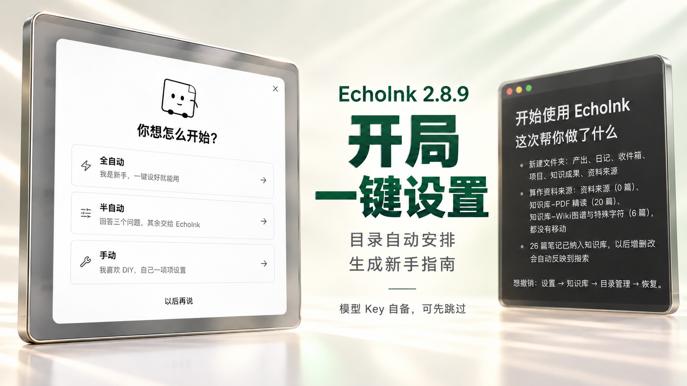

  

<h1 align="center">EchoInk Agent</h1>

你的笔记，有了 AI 搭档。住在 Obsidian 里。

  <a href="https://echoink.cn">官方网站</a> ·
  <a href="https://echoink.cn/install">下载与安装</a> ·
  <a href="https://echoink.cn/features">功能介绍</a> ·
  <a href="#news">News</a> ·
  <a href="#快速开始">快速开始</a> ·
  <a href="#探索">探索</a> ·
  <a href="#隐私与数据">隐私与数据</a> ·
  <a href="README.md">English</a>

  
  
  

EchoInk 是住在 Obsidian 里的个人知识 Agent。和笔记对话、整理知识、保留可查看和修正的长期记忆，也记录自己的日常。笔记留在你的 Vault，AI 功能连接你自己的模型服务；正常安装无需 Codex CLI。

## 核心功能

| 你想做的事 | EchoInk 怎么帮你 |
| --- | --- |
| 和笔记聊天 | 和笔记对话；电脑端可带附件，也可用 @Agent 正文管家（PRO）提出修改 |
| 把资料变成知识 | 知识库按用途分目录，从问题出发沿线索续读，围绕新资料增量整理，答案可追溯来源 |
| 让 AI 记住你 | 长期记忆可查看、修正、导出、忘记和恢复；管理已有记忆无需连接模型 |
| 记录每天 | 记录日记、管理待办；电脑端可开启日记自动整理，账单需 PRO |
| 多个 Agent 分工 | 工作台向不同 Agent 派发任务、查看提醒；电脑端可聘请专家 Agent（PRO） |
| 生成成品 | 电脑端从资料生成笔记、Canvas 或手绘图，也可使用 PDF 精读（PRO） |

## News

| 版本 | 日期 | 更新 |
| --- | --- | --- |
| [2.8.9](https://github.com/AKin-lvyifang/codex-echoink/releases/tag/2.8.9) | 2026-11-01 | 开局一键设置，新增手绘图、日记命名与专家聘请 |
| [2.8.8](https://github.com/AKin-lvyifang/codex-echoink/releases/tag/2.8.8) | 2026-10-29 | 电脑端可自动整理日记待办与账单，账单需 PRO |
| [2.8.7](https://github.com/AKin-lvyifang/codex-echoink/releases/tag/2.8.7) | 2026-10-28 | 工作台入口集中，新增 DeepSeek 搜索与运行记录导出 |
| [2.8.6](https://github.com/AKin-lvyifang/codex-echoink/releases/tag/2.8.6) | 2026-10-27 | 新增 @Agent 正文管家（PRO），修改确认后写回 |
| [2.8.5](https://github.com/AKin-lvyifang/codex-echoink/releases/tag/2.8.5) | 2026-10-26 | 新增三套外观与图片组，修复模型连接和记忆识别 |
| [2.8.4](https://github.com/AKin-lvyifang/codex-echoink/releases/tag/2.8.4) | 2026-10-23 | 修复知识整理、对话排版与工作台显示 |

完整记录见 [CHANGELOG](CHANGELOG.md) 与 [Releases](https://github.com/AKin-lvyifang/codex-echoink/releases)。

**请将各设备统一升级到 2.8.9。** 财务、英文日记、PDF 精读、@Agent 正文管家、专家聘请和 EchoInk MCP 服务需要有效 PRO；**PRO 不包含模型调用额度**，活动与价格以[官网](https://echoink.cn/plans)为准。**移动端仍为 Beta，本版未完成手机真机验收**，支持范围见下文。

## 快速开始

| 步骤 | 做什么 | 说明 |
| --- | --- | --- |
| 1 | 安装 | Obsidian 社区插件搜索 EchoInk，或到 [Releases](https://github.com/AKin-lvyifang/codex-echoink/releases) 下载 `main.js`、`manifest.json`、`styles.css`，放进 `.obsidian/plugins/codex-echoink/`，再在社区插件设置中启用。需要 Obsidian 1.11.4 及以上 |
| 2 | 开局设置 | 电脑端从工作台打开引导，选择「全自动」「半自动」或「手动」；自动或半自动路线核对清单后确认，已有笔记留在原位，完成后自动打开新手指南 |
| 3 | 连接模型 | 自备模型 API Key，也可稍后连接；目录设置和生成指南不调用模型，测试连接及主动开启资料提炼会消耗模型额度 |
| 4 | 开始用 | 打开工作台开始对话；正文内 @Agent 需要有效 PRO |

升级前请完整备份 Vault、插件设置和数据。手动升级时只替换官方三个文件，保留原有设置和数据文件，再重新启用插件。如需回退，请将升级前的完整备份与匹配的旧版插件一起恢复，不能只替换旧插件文件降级。

插件文件超过 Obsidian Sync Standard 的单文件 5 MB 限制。请在各设备上通过官方下载或社区插件分别安装、更新，不要依赖 Sync Standard 传输该文件。

## 探索

### 💬 对话与知识

| 功能 | 说明 | 基础版 | PRO 版 |
| --- | --- | --- | --- |
| Agent 对话 | 带笔记提问、继续或归档会话；电脑端支持附件 | ✅ | ✅ |
| 知识库问答（Ask） | 沿资料线索续读，回答提供实际来源 | ✅ | ✅ |
| 知识库整理 | 围绕新增或变更资料增量整理，更新已有知识并保留手写内容 | ✅ | ✅ |
| 从资料生成 | 电脑端从资料生成笔记、Canvas 或可编辑手绘图；手绘图需启用 Excalidraw 2.29 及以上及支持工具调用的模型 | ✅ | ✅ |
| PDF 精读 · 提取 | 电脑端提取原文、生成译文与精读；可选 MinerU 增强解析 | ❌ | ✅ |
| @Agent 正文管家 | 在笔记正文提问、查看修改提议，确认后写回；可撤销 | ❌ | ✅ |
| 联网搜索 | 默认关闭，可选 Tavily 或 DeepSeek，服务费用另计 | ✅ | ✅ |

### 🧠 记忆与方法

| 功能 | 说明 | 基础版 | PRO 版 |
| --- | --- | --- | --- |
| 长期记忆 | 浏览、修正、导出、忘记、恢复；知识检索会排除私有记忆 | ✅ | ✅ |
| Skill（内置与自建） | 内置基础 Skill、自建 Skill 和基础复盘 | ✅ | ✅ |
| 官方方法论 Skill 与知识复盘增强版 | 7 个官方方法论 Skill 与知识复盘增强版按需联网下载 | ❌ | ✅ |
| EchoInk MCP 服务 | 电脑端向同机外部 Agent 提供获准的知识、画像与记忆；默认关闭、只读 | ❌ | ✅ |

### 📅 每天的生活

| 功能 | 说明 | 基础版 | PRO 版 |
| --- | --- | --- | --- |
| 工作台 | 电脑端集中查看任务、提醒、入门卡片和所选城市天气 | ✅ | ✅ |
| 日记 | 支持自定义命名；电脑端可预览整理老日记并撤销移动 | ✅ | ✅ |
| 待办 | 管理分类、截止时间与完成状态；电脑端可开启从日记自动整理待办 | ✅ | ✅ |
| 财务 | 管理收支、预算、账单导入与分析 | ❌ | ✅ |
| 英文日记 | 电脑端生成英文稿，修正错误或明显不自然的英文，积累有学习价值的表达 | ❌ | ✅ |

### 🤖 Agent 团队

| 功能 | 说明 | 基础版 | PRO 版 |
| --- | --- | --- | --- |
| 多 Agent 任务 | 工作台管理不同 Agent 的任务；中断后由你选择继续。移动端“交给”只准备内容 | ✅ | ✅ |
| 专家聘请 | 电脑端浏览并聘请专家，从头像继续对话；解聘保留原对话 | ❌ | ✅ |

### 🎨 外观与平台

| 项目 | 说明 |
| --- | --- |
| 外观 | 极简黑白（Minimal）免费；荧光笔记（Highlighter）、黄白宣言（Manifesto）需有效 PRO；配套主题到 [echoink.cn/theme](https://echoink.cn/theme) 单独安装 |
| 电脑端 | 提供上述桌面入口；Windows、Linux 原生环境验证仍未完成 |
| 移动端 Beta | 移动 Beta 新增分别为 iPhone、iPad 设计的工作台、多 Agent 任务、六组设置和日记、待办、财务、知识库、英文日记页面；中断任务由你确认后继续，“交给”只准备内容。资料生成、生成模板设置与 PDF 精读仅在电脑端提供，任务不会跨设备同步。附件、CLI 和桌面后台知识任务尚未接通；Skills 只使用移动端已有工具，MCP 暂只保存配置。iPhone、Android 与部分 iPad 原生流程，以及 Windows、Linux 原生环境的验证仍未完成。 |

## 隐私与数据

### 数据存在哪里

- **本地内容：** 对话、笔记、知识、记忆、日记和财务记录保存在本地；插件不会默认上传整个 Vault。

- **模型凭据：** Provider API Key 与 OpenAI Codex Beta 登录凭据保存在当前 Vault 的插件设置中，请在可信设备和 Vault 中配置。

- **桌面账号存储：** 桌面端的账号会话和设备授权加密保存在 Vault 外的 **`~/.echoink/membership/`**。同一设备的授权由系统安全存储保护，各 Vault 的账号会话分别由 Obsidian 安全存储保护；安全存储不可用时无法完成持久设备授权，已有凭据会保留。

- **移动账号存储：** 移动端的账号会话和授权使用当前 Vault 的 Obsidian 安全存储，不写入普通插件设置。移动端按笔记库的客户端实例激活，同一设备上的不同库可能占用不同名额，可在设备管理中解绑不再使用的实例。安全存储不可用时仅保留本次会话状态。

### 联网到 echoink.cn 的功能

- **账号与授权：** **https://echoink.cn** 提供注册、登录、邮箱验证、兑换、订阅与设备授权服务，接收完成这些请求所需的账号资料和授权数据，包括生成的设备标识。PRO 插件需要 EchoInk 账号与有效权益；普通对话和知识库无需 EchoInk 账号。

- **官方 PRO Skill：** 官方 PRO Skill 从 **https://echoink.cn** 按需下载：7 个方法论 Skill 仅联网下发，知识复盘保留完整本地基础版，PRO 有效时使用远程增强版。目录公开，无 PRO 也能查看名称、简介和已有对比链接；下载正文需要登录、有效统一 PRO 权益和已激活设备。财务、英文日记、Obsidian 基本操作、此刻速记和待办 Skill 仍内置。

- **Skill 请求与缓存：** Skill 下载通过现有账号服务发送登录 Token、Skill 标识、设备标识、当前签名租约、插件版本、平台和可选的缓存版本，不发送笔记或对话。缓存为当前 Vault 实际插件数据目录（随配置目录与已有数据根目录选择）的 **`skill-cache/`** 中的版本化 Markdown，按账号、服务地址和设备隔离；它是普通本地文件，可以被复制。每次使用都须设备租约有效，且距离完整正文的 `issuedAt` 不满 7 天；读取缓存和“版本未变”响应不续期。只有临时网络故障可回退到仍有效的缓存；退出、到期、设备撤销或已知撤权后停止提供。完全离线时无法即时知道远端撤权。一次运行固定一个版本，下次运行才采用更新；正文不增加工具或权限。

- **专家目录与内容：** 专家目录与专家内容从 echoink.cn 获取；内容下载需要有效 PRO 和设备授权，请求包含专家标识、设备标识、签名租约、插件版本、平台和可选缓存版本，不在该下载请求中发送笔记或对话。下载内容会缓存在当前插件目录的 `expert-cache/` 中。

- **天气：** 天气为可选功能。搜索城市时，搜索词会发送到 echoink.cn；选中后，插件仅在当前库的设置中保存城市 ID 和名称，打开工作台及页面可见时每 30 分钟仅向 echoink.cn 发送城市 ID 查询天气。天气请求不带登录凭据或账号信息，不读取设备定位，不保存天气历史。天气来自 MET Norway 的近时估计，并非本地实况观测；天气及城市来源、许可和改编说明常驻通用设置。

- **工作台签到：** 工作台签到是联网账号操作。已登录时打开工作台会查询该账号在本地日期的签到状态；只有手动下拉晴天娃娃或按 ↓ 才提交签到，通过现有登录凭据将账号身份、本地日期和时区发送到 **https://echoink.cn**。签到跟随服务端账号保存，插件仅在内存缓存结果。不自动签到，不上传 Agent 使用天数、笔记或对话内容。

- **运行记录与上报：** 你可以在会话标题栏的「…」中导出运行记录，或主动上报到 echoink.cn。报告包含对话内容、读到的笔记片段、工具与运行日志、环境和错误记录；问题描述与选填的联系方式会一并上传，登录时会关联当前账号。已识别的密钥会自动隐藏，上传前请展开预览检查。报告用于排查问题，可能交给 AI 辅助分析，保存 180 天；提前删除请通过[帮助与支持](https://echoink.cn/support)提供报告编号联系作者。纯导出只在库内保存文件，不上传报告。

- **静态 PRO 说明：** 插件自身界面包含静态 PRO 权益说明，以及由你点击打开的官方 Skill 对比链接，不加载联网动态广告。

### 发送给第三方服务

- **模型请求：** 你选择的模型服务会接收当前 AI 请求所需的提示词、笔记、附件、记忆和工具结果。模型服务可能要求独立账号并另行收费；图片输入需要支持视觉的模型。

- **联网搜索：** 联网搜索默认关闭，可选择 Tavily 或 DeepSeek。开启后，搜索词发送至所选服务的 `api.tavily.com` 或 `api.deepseek.com`，返回的摘要与链接交给当前模型。两家服务分别配置账号和 API Key，费用由所选服务另行收取；连接测试也会发起一次真实搜索。Tavily 的连接测试使用 basic 搜索，消耗 1 credit，详见[官方计费说明](https://docs.tavily.com/documentation/api-credits)；DeepSeek 的查询限制与计费见[搜索文档](https://api-docs.deepseek.com/zh-cn/guides/search/)。

- **PDF 解析：** PDF 本地文字提取在设备上进行；使用 MinerU 增强解析时，PDF 会发送给 MinerU，需要独立凭据与第三方额度，留存政策由该服务决定。生成精读或译文所需的提取内容会交给所选模型。

- **收藏链接：** 收藏链接使用插件内置抓取，访问你主动提交的页面。

- **自定义服务与 MCP：** 自定义 Provider 与 MCP 会访问你配置的服务或本机命令。本地 MCP 进程使用当前用户的系统权限，并继承应用环境；插件内的工具确认不会将该进程限制在工作区内。

### 本机权限与外部 Agent

- **桌面工作区：** 桌面对话可以选择 Vault 外的本地工作区。文件访问遵循所选权限；“完全访问”会解除工作区边界。Vault 外附件仅在你明确选择、拖入或粘贴时读取。

- **EchoInk MCP 服务：** 桌面版 EchoInk MCP 服务需 PRO，默认关闭、只读，仅在 Obsidian 运行时监听本机回环地址。知识库、个人记忆与画像分开授权；外部 Agent 可读取笔记摘录、来源路径与版本、概念链接，以及获准的画像和记忆，并可能将内容发送给它的模型服务或保留记录。EchoInk 无法控制对方保存，也无法收回已发送内容；关闭共享或换令牌可停止后续访问。

- **知识检索范围：** 知识检索排除“私有记忆”和插件内部数据目录；这不构成对所有文件工具或第三方服务的全局访问限制。

### 不做的事

- **客户端遥测：** 插件不采集客户端使用遥测；官网与账号服务的数据处理见[隐私政策](https://echoink.cn/support#privacy)。

## 许可声明

EchoInk 按组件分别授权：基础部分采用标准的 [MIT 开源许可](licenses/MIT.txt)；财务、英文日记、会员与激活服务，以及 [LICENSE](LICENSE) 列明的其他 PRO 文件，采用 [EchoInk PRO 商业许可](licenses/PRO-LICENSE.txt)。整个插件包并非全部采用 MIT，也不能整体称为 OSI 开源软件。两套许可分别约束对应内容，不是对整套产品任选其一。

MIT 基础部分允许修改、再分发和商用。PRO 源码允许个人、非商业阅读与学习；持有有效 PRO 权益的用户，可以正常使用未经修改的官方发行版处理个人事务、工作和企业内部业务，但不得绕过激活，也不因此获得修改、分发 PRO 代码或将其用于其他商业产品的权利。这些用途须另行取得书面授权。订阅或激活码授予的是产品使用权，不是源码转售权。

两部分由同一个官方插件包提供，激活无需再次安装。此前的 MIT 授权和第三方许可继续有效。旧版方法论 Skill 正文已按 MIT 公开，联网下发不会收回这些既有权利；新增服务端正文的使用许可由内容发布方另行说明。你的笔记及独立创作的成果，不会仅因使用 EchoInk 而自动受到 PRO 许可约束。完整范围、素材例外与既有权利见 [LICENSE](LICENSE)，第三方材料见 [THIRD_PARTY_NOTICES.md](THIRD_PARTY_NOTICES.md)。
