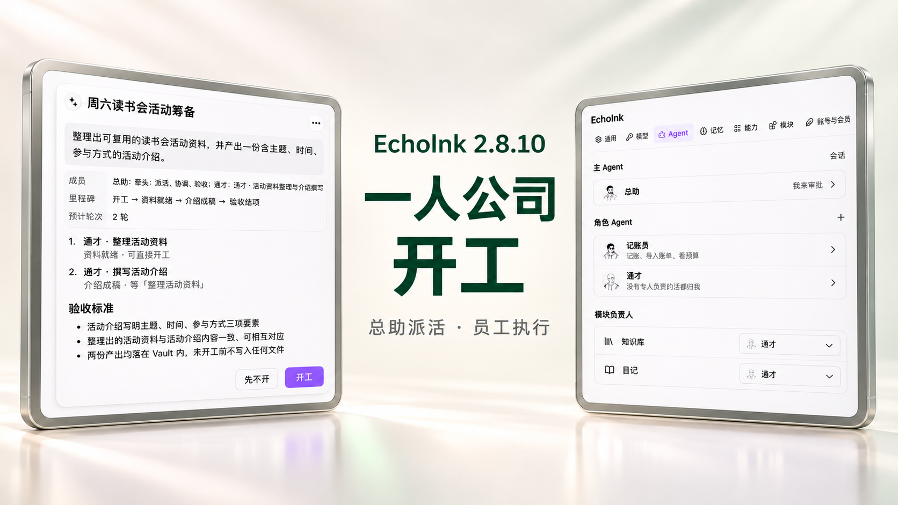

  

<h1 align="center">EchoInk Agent</h1>

你的笔记，有了 AI 搭档。住在 Obsidian 里。 和笔记对话、帮你整理知识，并用看得见、改得了的记忆记住重要的事。

<a href="https://obsidian.md/plugins?id=codex-echoink"><b>在 Obsidian 中安装</b></a>

  <a href="https://echoink.cn">官方网站</a> ·
  <a href="https://echoink.cn/features">功能介绍</a> ·
  <a href="https://echoink.cn/plans">订阅方案</a> ·
  <a href="#隐私一眼看懂">隐私</a> ·
  <a href="README.md">English</a>

  
  
  
  

## 能做什么

| | |
| --- | --- |
| 💬 **和笔记聊天** | 就整个笔记库提问，回答附上实际用到的来源。 |
| 📚 **把资料变成知识** | 把新资料整理进知识库，可体检并预览修复。 |
| 🧠 **看得见、改得了的记忆** | EchoInk 会逐渐了解你；每条记忆都能浏览、修正、固定或忘记。 |
| 📅 **日记、待办和账单** | 日记写一次，EchoInk 可整理出待办和账目。 |
| 🤖 **一支 AI 小团队** | 总助规划派活、角色 Agent 执行，关键决定由你确认。 |
| ✏️ **从资料生成成品** | 从已有资料生成笔记、Canvas 和手绘图。 |
| 🔌 **笔记就是 Agent 的个人上下文** | 本机 MCP 服务让你常用的其他 Agent 读取你授权的知识和记忆，无缝接上。 |

笔记留在你的 Vault。可以自备模型 API Key，也可以用 AI 点数调用内置模型。

## 开始使用

1. **安装**：[在 Obsidian 中打开 EchoInk](https://obsidian.md/plugins?id=codex-echoink)，或在社区插件中搜索 `EchoInk`。需要 Obsidian 1.11.4 及以上。
2. **开局设置**：打开工作台，选择「全自动」「半自动」或「手动」；已有笔记留在原位。
3. **连接模型**：填入 OpenAI 或兼容服务的 API Key，或登录后使用内置模型，就可以开始对话。

## 免费、PRO 与 Max

| | 免费 | PRO | Max |
| --- | :---: | :---: | :---: |
| 对话、知识库问答、知识库整理与体检 | ✅ | ✅ | ✅ |
| 长期记忆与记忆星图 | ✅ | ✅ | ✅ |
| 日记、待办、工作台 | ✅ | ✅ | ✅ |
| AI 团队、模块负责人、自建 Skill | ✅ | ✅ | ✅ |
| @Agent 正文管家、PDF 精读 | — | ✅ | ✅ |
| 财务、英文日记 | — | ✅ | ✅ |
| 专家聘请、官方方法论 Skill、EchoInk MCP 服务 | — | ✅ | ✅ |
| 云同步 | — | 1 GB | 5 GB |
| 内置模型 AI 点数（每月） | — | 500 | 3000 |

任何方案都可以自备模型 API Key，方案与价格见[官网](https://echoink.cn/plans)。

完整功能清单

### 💬 对话与知识

| 功能 | 说明 | 基础版 | PRO 版 |
| --- | --- | --- | --- |
| Agent 对话 | 带笔记提问、继续或归档会话；电脑端支持附件 | ✅ | ✅ |
| 知识库问答（Ask） | 沿资料线索续读，回答提供实际来源 | ✅ | ✅ |
| 知识体系与体检 | 电脑端按领域梳理知识树、快查与深查，预览确认后修复；模型判断需核对，深查与梳理消耗模型额度 | ✅ | ✅ |
| 知识库整理 | 围绕新增或变更资料增量整理，更新已有知识并保留手写内容 | ✅ | ✅ |
| 从资料生成 | 电脑端从资料生成笔记、Canvas 或可编辑手绘图；手绘图需启用 Excalidraw 2.29 及以上及支持工具调用的模型 | ✅ | ✅ |
| PDF 精读 · 提取 | 电脑端提取原文、生成译文与精读；可选 MinerU 增强解析 | ❌ | ✅ |
| @Agent 正文管家 | 在笔记正文提问、查看修改提议，确认后写回；可撤销 | ❌ | ✅ |
| 联网搜索 | 默认关闭，可选 Tavily 或 DeepSeek，服务费用另计 | ✅ | ✅ |

### 🧠 记忆与方法

| 功能 | 说明 | 基础版 | PRO 版 |
| --- | --- | --- | --- |
| 长期记忆 | 浏览、修正、导出、忘记、恢复与固定；淡出不删除，知识检索会排除私有记忆 | ✅ | ✅ |
| 记忆星图 | 电脑端查看画像、记忆与来源，从「设置 → 记忆」打开；可修正、固定或恢复记忆 | ✅ | ✅ |
| Skill（内置与自建） | 内置基础 Skill、自建 Skill 和基础复盘 | ✅ | ✅ |
| 官方方法论 Skill 与知识复盘增强版 | 7 个官方方法论 Skill 与知识复盘增强版按需联网下载 | ❌ | ✅ |
| EchoInk MCP 服务 | 电脑端向同机外部 Agent 提供获准的知识、画像与记忆；默认关闭、只读 | ❌ | ✅ |

### 📅 每天的生活

| 功能 | 说明 | 基础版 | PRO 版 |
| --- | --- | --- | --- |
| 工作台 | 电脑端集中查看任务、提醒、入门卡片和所选城市天气 | ✅ | ✅ |
| 日记 | 支持自定义命名；电脑端可预览整理老日记并撤销移动 | ✅ | ✅ |
| 待办 | 管理分类、截止时间与完成状态；电脑端可开启从日记自动整理待办 | ✅ | ✅ |
| 财务 | 管理收支、预算、账单导入与分析 | ❌ | ✅ |
| 英文日记 | 电脑端生成英文稿，修正错误或明显不自然的英文，积累有学习价值的表达 | ❌ | ✅ |

### 🤖 Agent 团队

| 功能 | 说明 | 基础版 | PRO 版 |
| --- | --- | --- | --- |
| 一人公司 | 电脑、iPhone 与 iPad 由总助派活，开工卡确认后推进项目；问题与审批集中在「等你定」；移动端为 Beta | ✅ | ✅ |
| 模块负责人 | 在 Agent 设置指定各模块的角色 Agent；未指定时先选人再开始，付费模块仍沿用各自权益 | ✅ | ✅ |
| 多 Agent 任务 | 查看员工任务与产出；中断后核对并继续，项目和员工会话暂不跨设备查看、接续 | ✅ | ✅ |
| 专家聘请 | 电脑端浏览并聘请专家，从头像继续对话；解聘保留原对话 | ❌ | ✅ |

电脑端与移动端支持

| 项目 | 说明 |
| --- | --- |
| 外观 | 极简黑白（Minimal）免费；荧光笔记（Highlighter）、黄白宣言（Manifesto）需有效 PRO；配套主题到 [echoink.cn/theme](https://echoink.cn/theme) 单独安装 |
| 电脑端 | 提供上述桌面入口；Windows、Linux 原生环境验证仍未完成 |
| 移动端 Beta | iPhone、iPad 提供工作台、一人公司、模块负责人、设置和日记、待办、财务、知识库、英文日记页面；问题与审批从「等你定」处理。项目和员工会话暂不跨设备查看、接续，只在 App 前台推进；回到前台按实际中断情况核对后继续。回答与思考可按模型服务设置流式显示，受服务商支持限制。记忆星图、知识体系梳理、知识库体检、资料生成、生成模板设置与 PDF 精读仅在电脑端提供。附件、CLI 和桌面后台知识任务尚未接通；Skills 只使用移动端已有工具，MCP 暂只保存配置。本版新增与修复未经 iPhone/iPad 真机验证，Android 原生验证仍未完成。 |

## 隐私一眼看懂

- **笔记留在本地**：对话、知识、记忆、日记和财务记录保存在你的 Vault，EchoInk 不会上传整个 Vault。
- **AI 请求发给你选择的模型服务**，使用你自己的 API Key，只带该请求所需的内容。
- **会联网到 echoink.cn 的功能**：账号登录与 PRO 授权、PRO Skill 与专家内容下载、可选的天气、工作台签到，以及你主动上报的问题报告。PRO 需要 EchoInk 账号，对话和知识库不需要。
- **可选的第三方服务**：联网搜索（Tavily 或 DeepSeek，默认关闭）和 MinerU PDF 解析，账号与费用各自另计。
- **电脑端可以访问 Vault 外的文件**，范围取决于你选择的权限；也会运行你配置的本机 MCP 命令。
- **不采集客户端使用遥测。**

完整内容见[隐私与数据说明](PRIVACY_CN.md)。

## 使用须知

- **升级前先备份**：完整保留一份 Vault 和插件数据。
- **Obsidian Sync Standard**：插件文件超过它的单文件 5 MB 限制，请在每台设备上分别安装和更新。
- **移动端为 Beta**：本版改动未经 iPhone、iPad 真机验证。

手动安装、升级与回退步骤

| 步骤 | 做什么 | 说明 |
| --- | --- | --- |
| 1 | 安装 | Obsidian 社区插件搜索 EchoInk，或到 [Releases](https://github.com/AKin-lvyifang/codex-echoink/releases) 下载 `main.js`、`manifest.json`、`styles.css`，放进 `.obsidian/plugins/codex-echoink/`，再在社区插件设置中启用。需要 Obsidian 1.11.4 及以上 |
| 2 | 开局设置 | 电脑端从工作台打开引导，选择「全自动」「半自动」或「手动」；自动或半自动路线核对清单后确认，已有笔记留在原位，完成后自动打开新手指南 |
| 3 | 连接模型 | 自备模型 API Key，也可稍后连接；目录设置和生成指南不调用模型，测试连接及主动开启资料提炼会消耗模型额度 |
| 4 | 开始用 | 打开工作台开始对话；正文内 @Agent 需要有效 PRO |

升级前请完整备份 Vault、插件设置和数据。手动升级时只替换官方三个文件，保留原有设置和数据文件，再重新启用插件。如需回退，请将升级前的完整备份与匹配的旧版插件一起恢复，不能只替换旧插件文件降级。

插件文件超过 Obsidian Sync Standard 的单文件 5 MB 限制。请在各设备上通过官方下载或社区插件分别安装、更新，不要依赖 Sync Standard 传输该文件。

## 最近更新

**2.8.10**（2026-11-06）：一人公司、模块负责人、记忆星图与知识库体检。完整记录见 [CHANGELOG](CHANGELOG.md) 与 [Releases](https://github.com/AKin-lvyifang/codex-echoink/releases)。

## 许可

基础部分按 [MIT 许可](licenses/MIT.txt)开源；财务、英文日记、会员等 PRO 组件采用 [EchoInk PRO 商业许可](licenses/PRO-LICENSE.txt)。完整范围见 [LICENSE](LICENSE)，第三方材料见 [THIRD_PARTY_NOTICES.md](THIRD_PARTY_NOTICES.md)。
